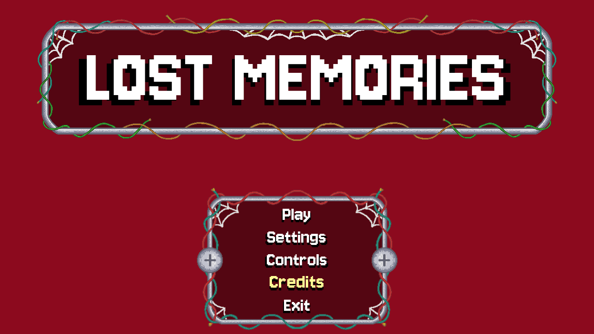

# Lost Memories

Pixel-art game in progress, written in Python with pygame-ce. It currently has its title screen: a fade-in, a title that rises and falls by a few pixels, ornamental borders and a menu whose options grow and turn yellow under the mouse.


## Screenshots




Captured by running the game with SDL's dummy video driver; the mouse movement in the GIF was simulated to show the hover effect.

## How it works

- [`main.py`](main.py) opens a 1280x720 `pygame.Window` and runs the menu loop at 60 frames per second.
- [`animations.py`](animations.py) has `fade_in`, which raises the opacity of the background and the title step by step before the menu starts, and `breath_step`, which returns the title's vertical offset from an eight-step sequence (0, up 2 px three times, 0, down 2 px three times), holding each step for 10 frames.
- [`menu.py`](menu.py) draws the title with its shadow and each menu option. An option checks whether the mouse is inside its rectangle and, if so, is drawn with the larger font and the hover color.
- [`visuals.py`](visuals.py) places the border images by percentage of the window size and loads each image only once.
- [`fonts.py`](fonts.py) loads the Jersey 10 font in the sizes the screens use.

Elements are positioned by percentages of the window size rather than fixed coordinates. Code comments are in Brazilian Portuguese.

## Status

Only the title screen exists. The menu options react to the mouse but do not open anything yet.

## Running

Requires Python 3 and pygame-ce. Run it from the project folder, since the fonts and images are loaded with relative paths:

```bash
python3 -m pip install -r requirements.txt
python3 main.py
```

## Credits

The [Jersey 10](https://fonts.google.com/specimen/Jersey+10) font is by Sarah Cadigan-Fried and is distributed under the SIL Open Font License 1.1 ([`fonts/OFL.txt`](fonts/OFL.txt)).

## License

The code is released under the [MIT License](LICENSE). The font keeps its own license.

## Author

Pedro Ross. [GitHub](https://github.com/PedroRossZny) | [LinkedIn](https://www.linkedin.com/in/pedro-ross)
